<p align="center"></p>

<h1 align="center">Dostoevsky</h1>

A writing app for macOS. While you write, it's a quiet page: no marks, the rest of the draft
dimmed, the text hidden when someone's looking. When you edit, it keeps every version of a word,
sentence or paragraph where it belongs. Hover over a phrase, press ↓, and read the next version
in place. Nothing gets deleted: you choose later, with the real sentence around it.

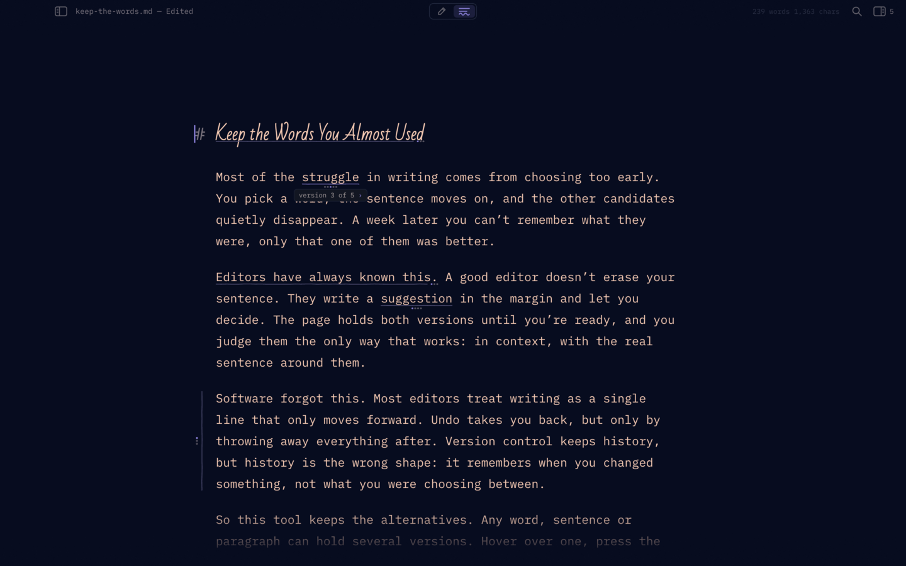

While you write:

- **Writing mode.** No underlines, no dots, no margin notes; the header fades while you type.
- **Zen writing.** The sentence, line or paragraph you're in stays bright, and the rest fades with distance.
- **Private mode.** The page turns to blurred ink, and only the sentence you're writing stays readable.
- **Your page.** Five light-and-dark themes or your own, four typefaces, typewriter scrolling.

When you edit:

- **Alternatives.** Any span can hold several versions. You flip between them in place.
- **Cuts.** ⌘X keeps what it cuts: the text fades where it was, ⌘V moves it, and the Cuts panel keeps every cut with its place. In a project, the panel reaches every chapter.
- **Comments.** ⌥⌘M leaves a note in the margin, beside the words it's about. The final text never includes them.

The first launch opens a welcome page: the opening of *Crime and Punishment* with versions, cuts
and comments already in it, each comment naming the keys to try. Help → Welcome to Dostoevsky
opens a fresh copy.

Everything is saved in one Markdown file that any other editor can still open. AI is
optional, and it never rewrites your text.

Built in Rust on [GPUI](https://www.gpui.rs) ([gpui-kit](https://docs.rs/gpui-kit/)). Native, with no web view.
Free and open source. Website: [dostoevsky.app](https://dostoevsky.app).

---

## Writing mode

The switch in the middle of the header picks **writing** (the pencil, ⌘1) or **editing** (the
marked lines, ⌘2); ⌘D flips between them. In writing mode the underlines, dots and comments go away, the arrow keys
only move the caret, and text doesn't drag. Switching never moves a line: cuts stay faded in
both modes, and paragraphs keep their places. The header fades while you type. Asking for something
only editing shows (⇧⌘A, ⌥⌘A, a hidden version in Find, a Review pass) switches to editing first,
and the mode switch pulses so you see why the underlines came back. Writing closes the panels,
and each mode puts back the ones it had when you left it; editing opens on the Review tab the
first time. Panel tabs live where you put them: drag a tab's label (Project, Alternatives,
Review, Cuts, Comments) to the other side's header, or use its menu's Move to Left / Right Panel;
View → Reset Panel Layout puts them back.

**Zen writing** (⌃⌘Z) dims the draft around what you're writing. Preferences → Writing sets what
*stays bright*: the sentence, the line or the paragraph with the caret. *Distance fade* lets the
rest fade the further it is from you (Near, or the Whole page) instead of all at once.
**Typewriter scrolling** (⌃⌘T) keeps your line in the middle of the window.

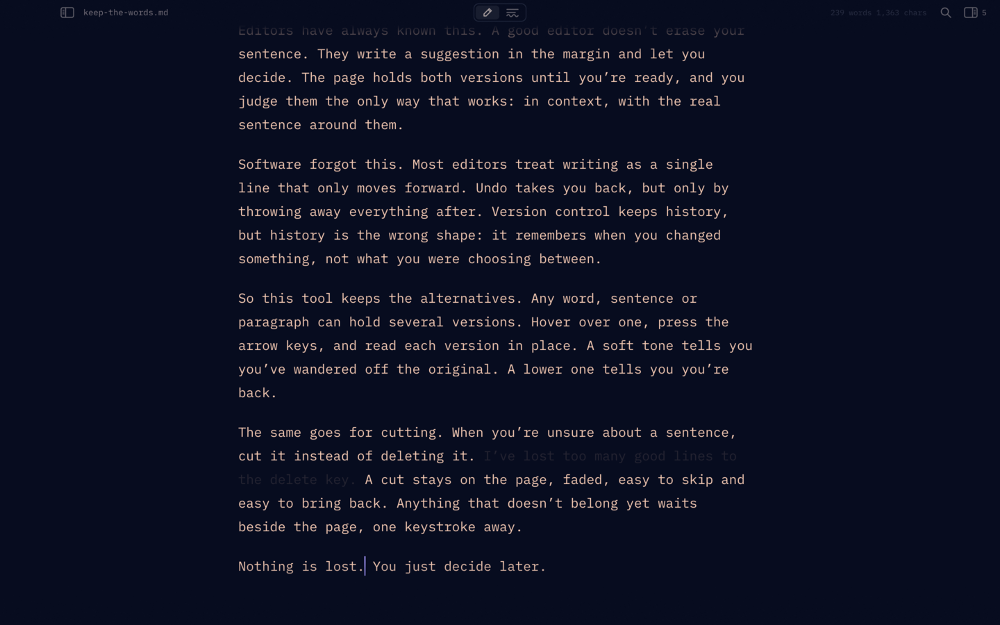

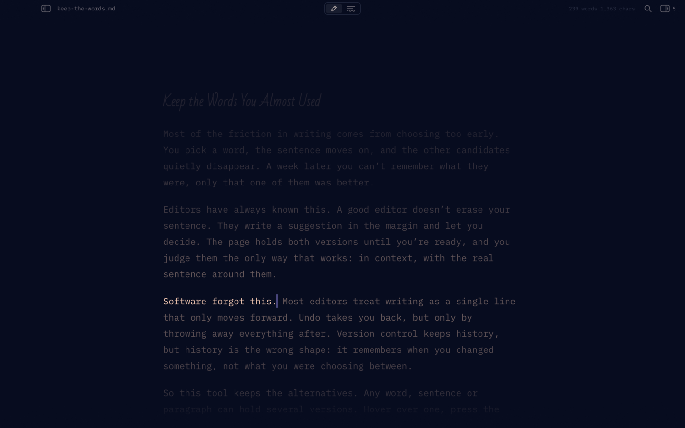

**Private mode** (⇧⌘H) hides the page while you write, for the train, a café, a shared screen,
or the urge to reread instead of writing on. The text turns to dots, bars, solid bars or blurred
ink (Preferences → Writing → *Hidden text looks*), and *Stays visible* keeps the word or the
sentence you're writing readable, or nothing at all. It only paints: the file is untouched, and editing shows every word.

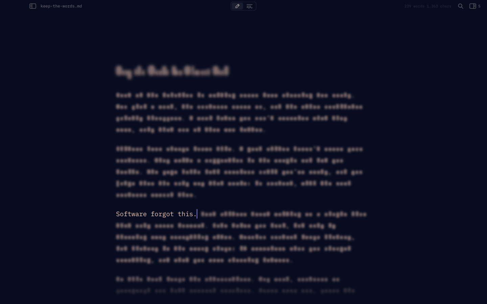

Spelling is checked by macOS in every language you have set up, mixed in one file if that's how
you write. *Check spelling* (Preferences → Writing) is Always, Editing only (writing mode stays
unmarked) or Off.

**Sentences.** ⌃⌘← / ⌃⌘→ walk by sentence (⇧ selects), and ⌃⌘↑ grows the selection from a
word to its group, its sentence, then its paragraph (⌃⌘↓ steps back). In editing, ⌥↑ / ⌥↓ move
a selected sentence or paragraph past its neighbour, with the spaces fixed and its versions
along. Preferences → General → *Tap ⇧ to select* makes a tap of ⇧ grow the selection too.

The counter in the header (words and characters, or the selection's while you have one) opens
**Statistics**: words, characters, paragraphs, reading time and reading ease.
Reading ease runs 0–100, higher meaning easier, with one formula per language (Flesch for
English, Oborneva for Russian, Amstad for German, and so on), the language read from the text
itself. In a project there are columns for the chapter and the whole book.

## Your page

A **theme** is a pair, a light page and a dark one: Dostoevsky, Petersburg, Manuscript, White
Nights and Aurora are built in. Preferences → General → *Appearance* picks Dark, Light or Match
macOS (⌃⌘L switches by hand), and *Theme* picks the pair. *New* makes your own from three
colours a half (paper, ink and an accent) and says so when a pair gets hard to read;
*Import a theme file…* reads a Dostoevsky or VS Code theme. Themes are plain JSON files
([docs/THEMES.md](docs/THEMES.md)).

Fonts are IBM Plex Mono, JetBrains Mono, iA Writer Quattro or Literata, a serif, in four sizes
(⌘= and ⌘− step through them, ⌘0 goes back to the default), with five column widths and three line
spacings, ragged or justified, with or without hyphenation. Paragraphs are set apart by a gap or
by an indent (Preferences → Page → *Paragraphs*); the file keeps Markdown's blank line either way. Headings
are set in a hand, a step larger per level, and their `#` shows in the margin when the caret is
on them. The hand is Bad Script, Caveat or Shantell Sans (Preferences → General → *Hand font*),
and Page → *Headings* puts them back in the page font, bold. The background can go down to 50%
opacity for a blurred-glass window.

Preferences (⌘,) have five sections: General (language, theme, files, keyboard), Page (the
font and the column, shown on a sample of your own document, or a passage from Dostoevsky when
it's empty), Writing, Editing and AI, plus Project in a project window. The interface speaks
English, Deutsch, Español, Français, Italiano, Português (Brasil) and Русский: it follows macOS,
or pick one in General → *Language*.

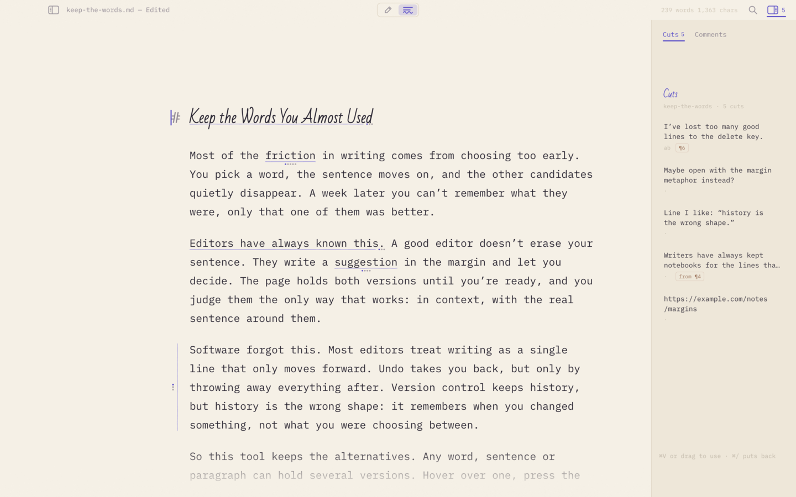

## Alternatives

Select a word, a sentence or a paragraph and press **⌘⇧A**, or click *Alternatives* in the
bar that shows above a mouse selection in editing (beside *Comment* and *Cut*; Preferences →
Editing → *Buttons on a selection* turns it off). What you selected becomes the
original, and you add versions under it. Back on the page, hover the span and press
**↑ / ↓** (or scroll, or swipe sideways on the trackpad) to swap versions in place.

- A wavy, pen-like underline marks each group, with one dot per version under it. The
  filled dot is the version showing. The original's ring is larger, so you can see that
  you've moved off it.
- A small label under the dots says where you are: `version 3 of 5 ›`. Click it to open the
  group in the panel.
- Each step plays a soft tone. Landing back on the original plays a lower one.
- Cycling is one undo step per run, so ⌘Z after browsing six versions takes you back to
  the one you started on.
- **⌥⌘↩ Settle on this** keeps the version showing as plain text and drops the rest. Settling
  can be undone too.

Paragraph groups get a rule in the left margin, and the version you're previewing is washed
so it stands out from the rest of the page:

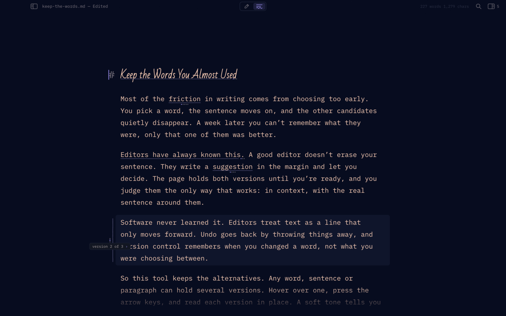

### The alternatives panel

The panel on the left shows one group's versions with the sentence around it. Click a
version or press ↑/↓ to try it on the page. Type to add one, or press *Ask AI for ideas* under
the field. ⌫ on an empty line removes the version showing, with a small explosion
(⌘Z brings it back).

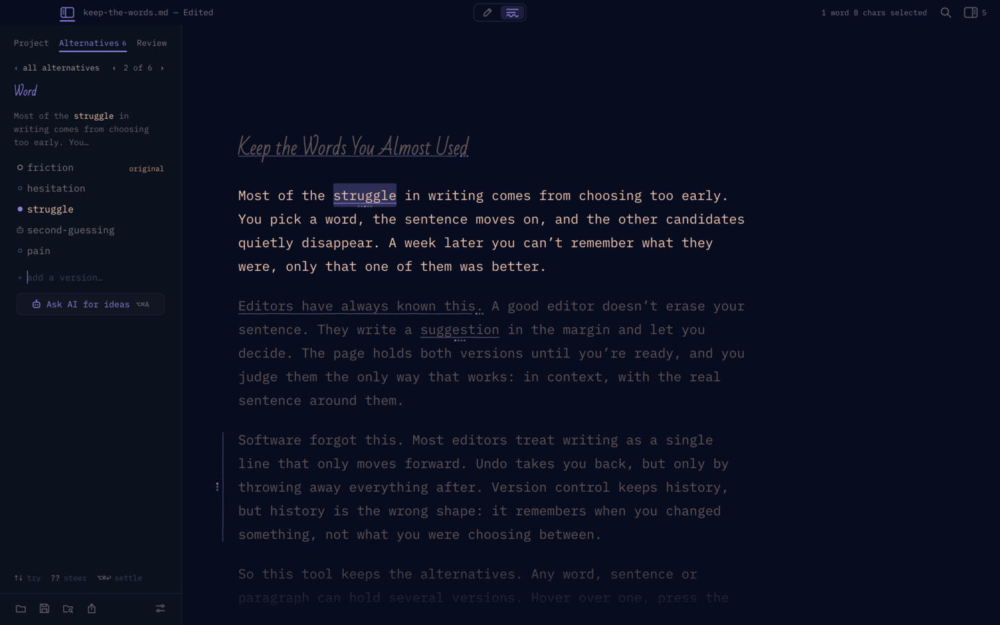

Press Esc to step back to the list of every group in the file, in page order under its
headings. ↑/↓ glides the page to each one.

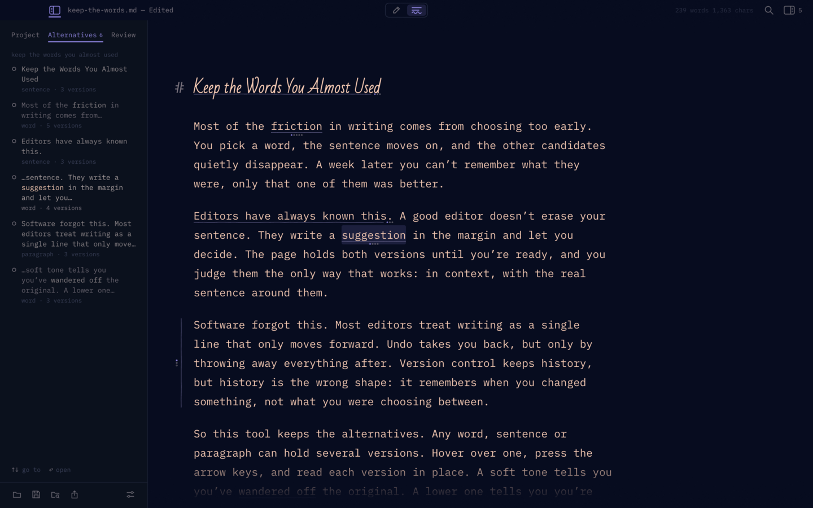

## Cut it

**⌘X** fades the selection where it was: the page doesn't move, your eye skips it, and the
word count, Copy Final Text and every export leave it out. It is on the clipboard too. Press
**⌘V** somewhere else, in this chapter or another, and it moves there (one ⌘Z puts it back);
press **esc** straight away and it goes back. **⌘/** (or *Cut* above a mouse selection, the
app icon's axe) cuts without touching the clipboard, and on a cut puts it back. Only ⌫ deletes.

Right-click a cut for its menu: put it back, show it as a quiet mark instead of faded text,
find it in the Cuts panel, forget its spot, or delete it for good. Preferences → Editing →
*Show cuts as* picks faded text or a mark for every cut.

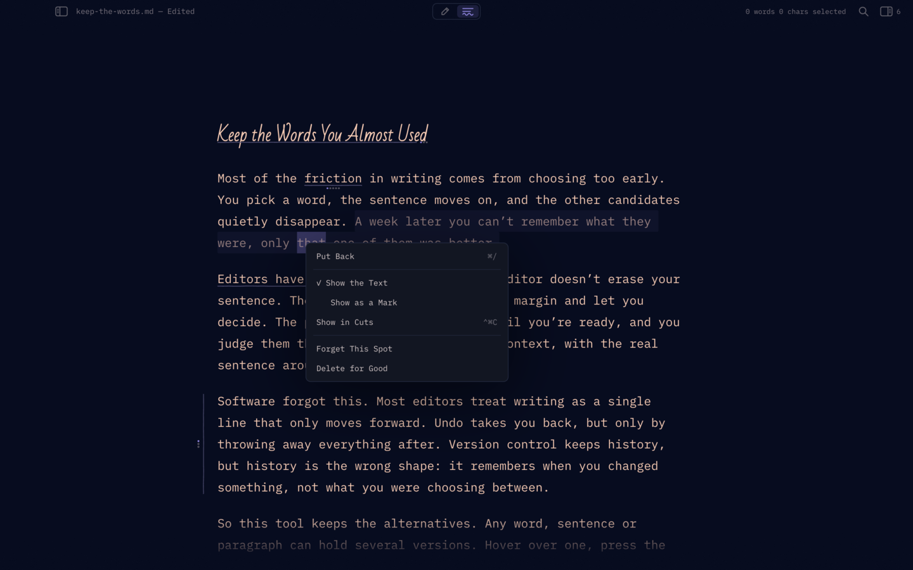

## The Cuts panel

**⌃⌘C** opens Cuts on the right: every cut on the page in text order, each with a glyph for
what it left (faded text, a mark, or no trace) and a chip for where it was (`¶2`, `from ¶4`).
Click a cut to select it and bring its place to the middle of the page; double-click it to edit
its text. **⇧⌘X** cuts without a trace: the text flies into the panel and the page shows nothing,
but the cut still remembers its place. Drag a cut onto the page (⌥ keeps it), or select it and
press ⌘↩, to use it. You can also drag a selection onto the panel.

In a project the panel switches between *this page* and *the whole book*, grouped by chapter.
A project keeps its cuts in `cuts.md` at the top of the folder, never in the chapters, so
another editor sees only the text you kept.

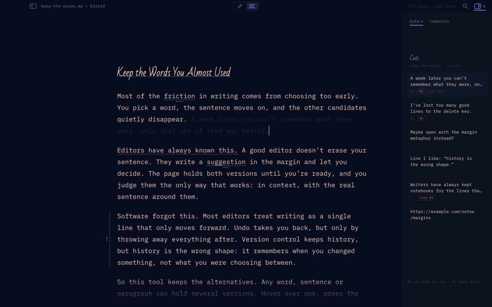

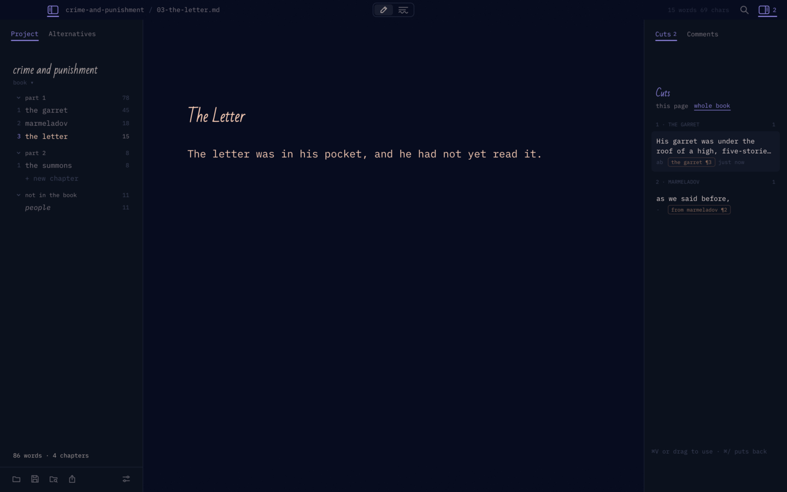

## Drag it

In editing, press inside a selection and move: the text lifts off. It stays faded and outlined
where it was, a card follows the pointer, and a caret shows where it will land. Words and
sentences go between words, and the spaces on both sides fix themselves. Whole paragraphs go
between paragraphs. ⌥ copies instead of moving, Esc puts it down where it was, and one ⌘Z
undoes the move. Groups and cuts travel with the text.

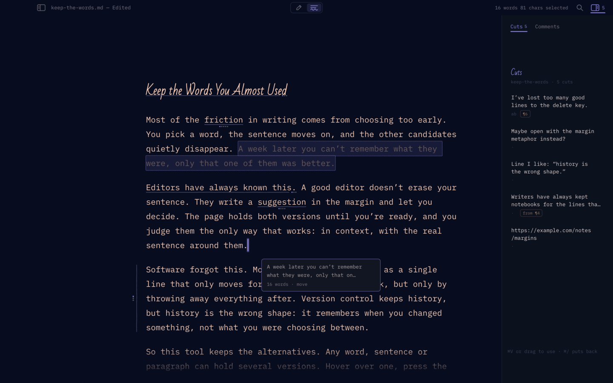

## Comments

Select some words, or just put the caret in a sentence, and press **⌥⌘M** (or click *Comment*
above a mouse selection, or right-click → *Add Comment*). The words take a faint wash and a note opens in the right margin, level with
them. ↩ or esc finishes it, ⇧↩ starts a new line, and a note left empty leaves nothing. Point
at a note or its words and both light up; click the note to edit it. Right-click for Edit, Copy,
Show in Comments and Delete (⌘⌫), each one ⌘Z away.

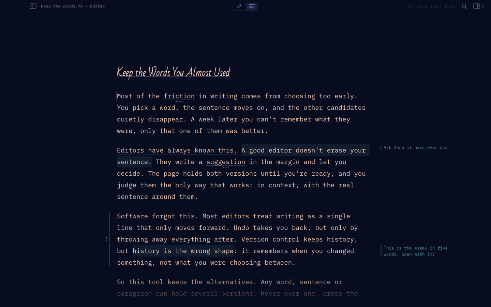

Where the margin has no room, or with Preferences → Editing → *Show comments as* Ticks, a note
becomes a short tick by its line that shows the note when you point at it. Comments follow
their words: typing inside grows them, a cut takes its comments along (*Put Back* brings both),
and a comment inside one version shows only with that version.

The right panel has a **Comments** tab beside Cuts, with this page or the whole book. A Review
mark's row has *Make a comment*, so a mark you agree with outlives *Close*. Copy Final Text, every
export and the counts leave comments out; Word export can send them as Word comments
(*My comments*).

## AI, if you want it

AI is off until you set it up, and it only runs when you ask. It suggests and it marks. It
never changes a word of yours by itself. The *Use AI* switch at the top of Preferences → AI
turns it all off: the AI items leave the menus and the shortcuts, and Review keeps only the
marks your Mac finds by itself.

**Ideas (⌥⌘A, *Ask AI for ideas* in the panel, or `??`).** Five suggestions arrive in the group you're on, below
yours, each marked with a small robot so you can tell them from your own. The model is sent the paragraph around
the word, the title and the versions you already have, so you get ideas that fit the
sentence, not a thesaurus list. Words after `??` steer them: `?? plainer`. After a bare `??`
the field offers, faded, the steer you use most (*more concrete ⇥*); ⇥ takes it, and ⇥ again
the next.

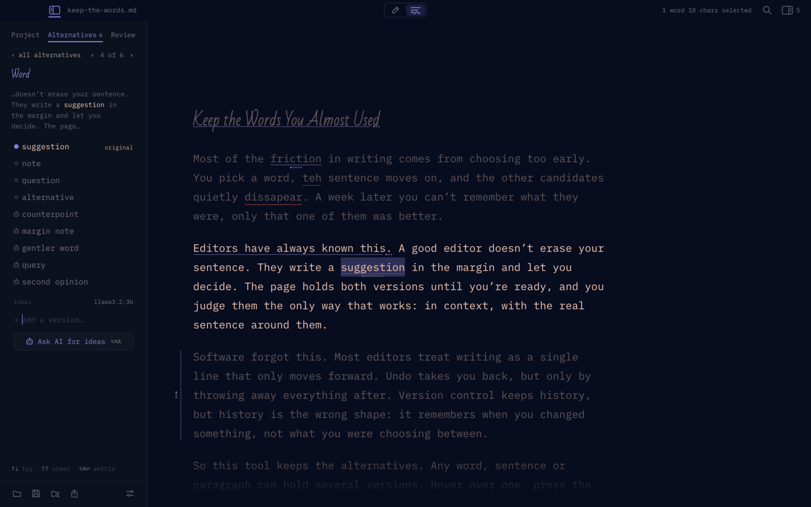

**Review (⌥⌘L, or the Review tab of the left panel, in editing).** Three passes and Trim, each
saying what it looks for. Choose one and press its Run; ↑↓ and ↩, or 1–4, from the keyboard. Hard to read
and Word choice work without a model too: they mark what your Mac finds on its own (long and
passive sentences, echoes), and Fix mistakes and Trim wait until you set one up.

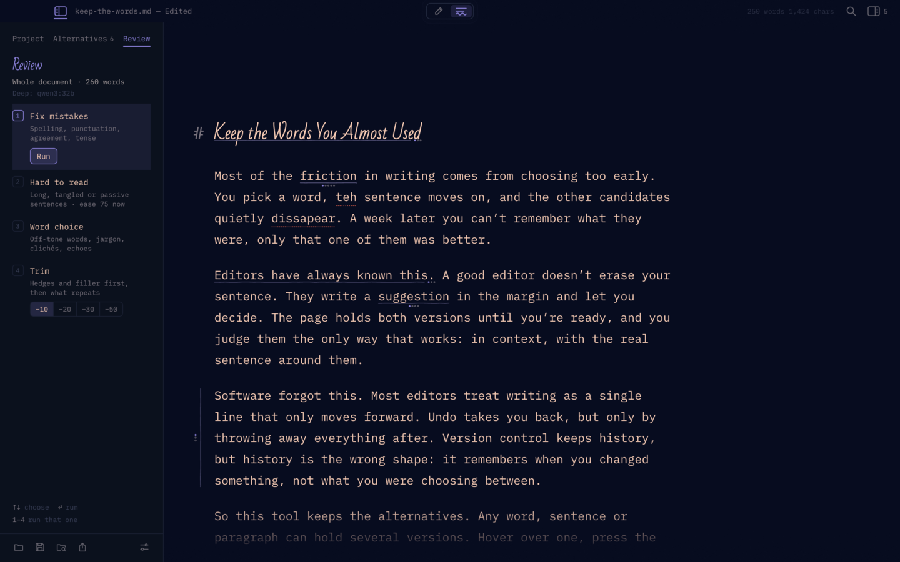

**Fix mistakes** turns each fix (a typo, punctuation, a verb that slips out of the passage's
tense) into a word group: the page shows the fix, and the mistake stays as the original, one ↑
away. A sentence a few words can't put right is marked for versions instead. The results are a
list in the tab. Each row shows the change inside its sentence, drawn as the page draws it (the
mistake struck, the fix washed), with a line saying why (*spelling*, *doubled article*). Its
buttons act on that row only: *Settle on* “the” or “teh” drops the other, *Keep both* leaves the
group in the text with the fix showing (a typo has nothing to keep, so it has no Keep). The
buttons under each section act on all its rows and say how many (*Settle all on* fixes / mine,
*Keep all 3*). What you dealt with stays, dimmed. Each pass keeps its own results until you
*Close* them, which leaves the text and its alternatives as they are.

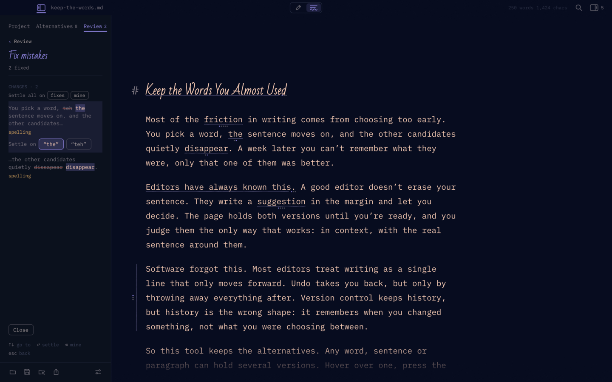

**Hard to read** marks sentences that run long or in the passive voice at once (found on your
Mac) and tangled ones when the model answers; **Word choice** marks a word used again a few
lines later at once, and words that jar when the model answers. Hard to read's row in the tab
ends with the text's reading ease. The marks are amber, with a note in the margin, and each
row leads to versions or alternatives you choose from (*Suggest versions*), to a comment of
your own (*Make a comment*), or away (*Dismiss*) when the pass got it wrong.

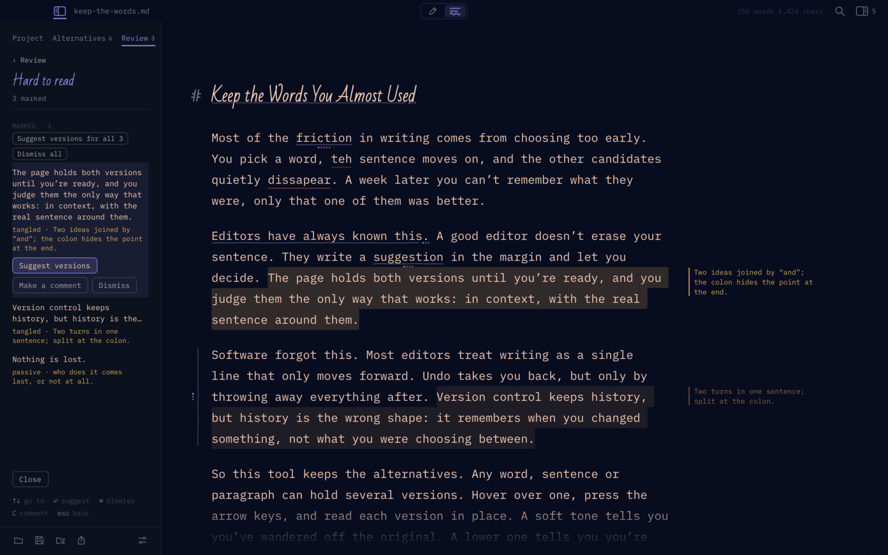

**Trim** fades the words that could go, hedges and filler first, and strikes them through. A
slider says how much, up to half, with −10 / −20 / −30 / −50% marked on it; moving it asks nothing new. The cuts are listed in page order: keep one (K, or click
its word), or *Cut N words*, which cuts them, one entry in the Cuts panel, so they're still there.

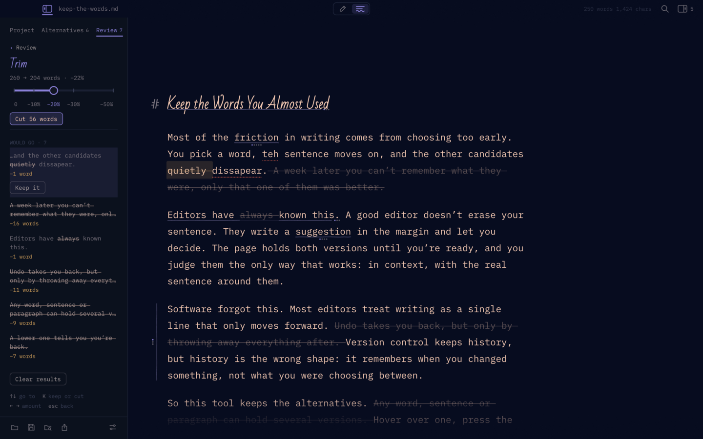

**Setup (Preferences → AI).** Connect OpenRouter in one click (OAuth in the browser, no key
to copy), add an OpenAI key, or use a model on your own Mac through Ollama or LM Studio. Any
OpenAI-compatible server works. Pick a *Quick* model for ideas and a *Deep* one for AI passes and trims,
from any of your services. The model menu opens with a search field: type a few letters of a name
(`claude son`, `qwen 32`) and it lists the matching models of every service. Keys go in the macOS
Keychain.

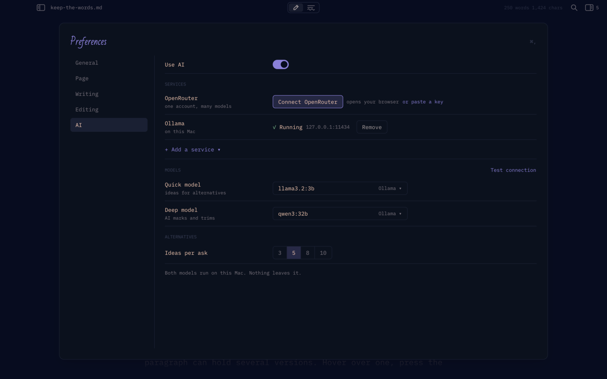

## Projects: books, journals, folders

Open a folder and it becomes a project: a **book** (numbered chapters, in parts), a
**journal** (one dated page a day; ⌘N goes to today), or a plain **folder**. Order lives
in the file names and the type in a small `.dostoevsky` file, so the folder still makes sense
in Finder, git or Obsidian. ⌘P opens the list, ↑/↓ flips through the chapters, dragging
a chapter renames the files to match, and *+ new chapter* under the list adds one, its name
already on the page as a heading.

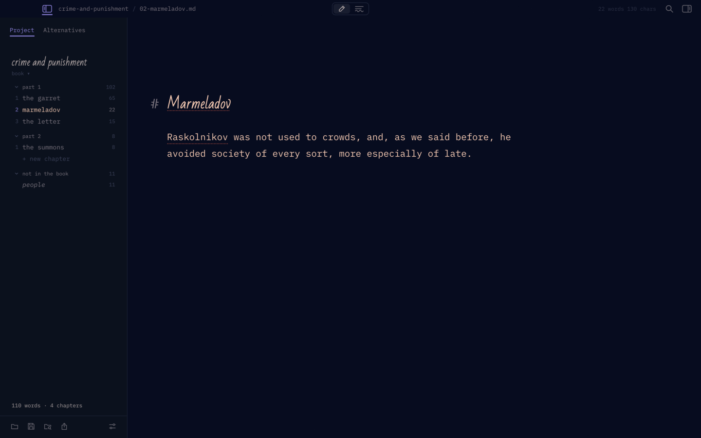

Find (⌘F, or the magnifier in the header) covers this chapter or the whole book, and looks in
cuts, hidden versions and notes, with match case and whole words. ⌘G
walks the whole book, opening the next chapter with a match.

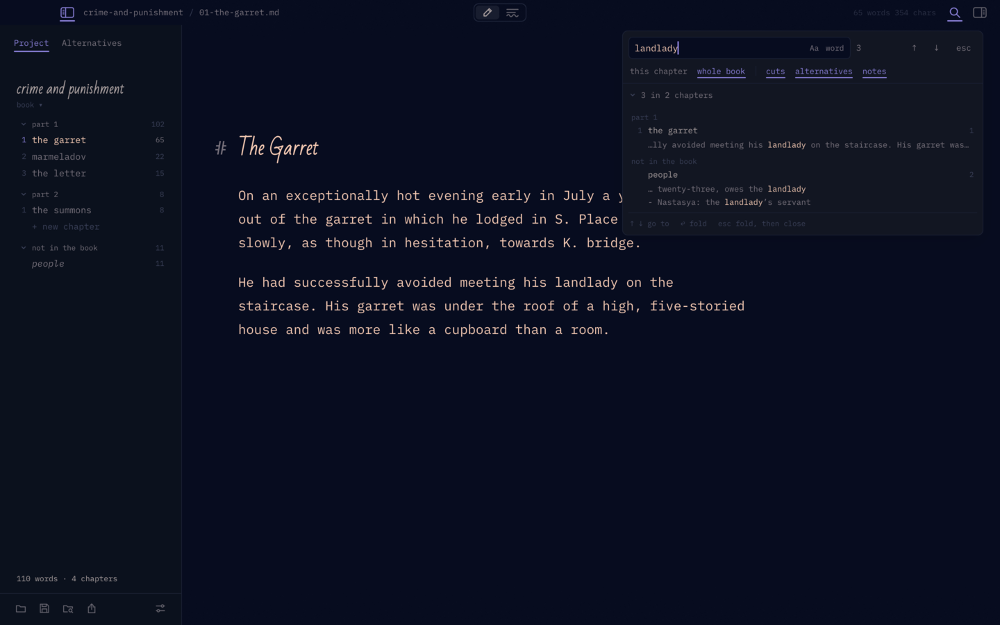

The foot of the left panel has Open (recent documents and projects, New Project), Save, Show in
Finder, Export and Settings. A project's type and notes folder are Settings → Project. A single file gets a Project tab too: its folder,
one click to open that folder as a project, and your recent work.

## One Markdown file

The page is plain Markdown. Versions, cuts and comments go in HTML comments at the end
of the file, so other editors show clean text, and a file with none of them is saved as pure
Markdown with no comment block.

Saves are atomic. Autosave runs after two seconds idle, the last 20 versions of each file are
kept as backups, and unsaved work survives a crash. If the file changes on disk (another
editor, sync, git), the app reloads it and puts every group back on its text. A group it
can't place goes to *Detached*, so nothing is dropped. The format is documented in
[docs/FILE-FORMAT.md](docs/FILE-FORMAT.md).

## Getting it out

**The final text** is what a reader sees: the version showing in each place, no cuts, no
comments. **⌘⇧C** copies it formatted and as Markdown at once, so a paste into
Mail, Google Docs, Substack or Medium keeps the headings and italics, and a paste into X or a
Markdown editor gets Markdown.

**⌘⇧E** opens *Export*: this page or the whole book, as PDF, Word, ePub, a web page, Markdown
or plain text, in one of three looks. *Page* is your own font, set for paper. *Manuscript* is
the standard submission format (12 pt Times, double-spaced, a title page and a running head).
*Book* is a serif, justified and hyphenated, with indented paragraphs. The preview shows the
pages as they will be. *Text* changes the font, size, spacing, alignment, hyphenation and
paragraphs for the export alone. Word can carry the other versions of each place as comments,
so an editor reads the chosen text and still sees what you were choosing between. **⌥⌘P**
prints. The choices are remembered for each book, and a book's title and author are kept in
its folder.

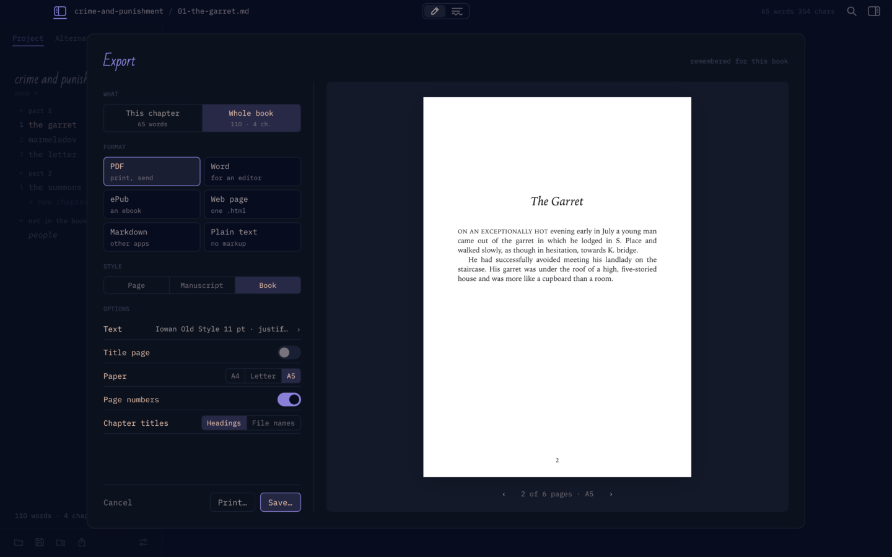

## Keyboard

Every command has a shortcut and a menu item, and every binding can be changed in
`~/.config/dostoevsky/keymap.json` (changes apply live). ⌘⇧K lists them all.

| Action | Keys | | Action | Keys |
|---|---|---|---|---|
| Next / previous version (pointer) | ↓ / ↑ | | Cut / put back | ⌘/ |
| Next / previous version (caret) | ⌥⌘↓ / ⌥⌘↑ | | Cut without a trace | ⇧⌘X |
| Next / previous group | ⌥⌘→ / ⌥⌘← | | Cuts | ⌃⌘C |
| Back to the original | ⌥⌘0 | | Move a sentence up / down (editing) | ⌥↑ / ⌥↓ |
| Alternatives for selection | ⌘⇧A | | Copy the final text / Export | ⌘⇧C / ⌘⇧E |
| Settle on this | ⌥⌘↩ | | Left panel (project, alternatives, review) | ⌘P |
| Writing / editing (flip with ⌘D) | ⌘1 / ⌘2 | | Previous / next file | ⌘[ / ⌘] |
| AI ideas | ⌥⌘A | | Review tab | ⌥⌘L |
| Find next / previous | ⌘G / ⇧⌘G | | Find in the project | ⇧⌘F |
| Zen writing | ⌃⌘Z | | Typewriter scrolling | ⌃⌘T |
| Private mode | ⇧⌘H | | Light / dark | ⌃⌘L |
| Text bigger / smaller / default | ⌘= / ⌘− / ⌘0 | | Add comment | ⌥⌘M |
| Next / previous sentence | ⌃⌘→ / ⌃⌘← | | Grow / shrink the selection | ⌃⌘↑ / ⌃⌘↓ |

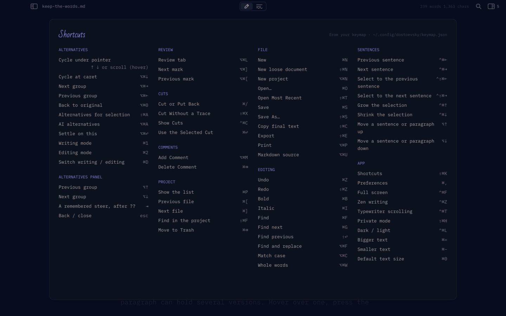

---

## Build and run

macOS 13 or later, Apple silicon or Intel. Rust is pinned by `rust-toolchain.toml`, so
`rustup` installs the right version on the first build.

```bash
cargo run -p dostoevsky [file.md | folder…]   # the app
cargo test --workspace                        # unit, property and headless app tests
scripts/bundle.sh                             # universal Dostoevsky.app and .dmg
```

The screenshots on this page come from the real app, rendered offscreen by
`scripts/shoot_readme.sh` (the AI shots use a stand-in model on localhost). More commands
are in [CLAUDE.md](CLAUDE.md); the release checklist is [docs/RELEASE.md](docs/RELEASE.md).

| Crate | What it does |
|---|---|
| `crates/english` | Word characters, word counts |
| `crates/prose` | The text's language and its reading ease, for Statistics; echoes for Word choice; the sentence finder. No UI |
| `crates/l10n` | The interface's seven languages: catalogs and plurals |
| `crates/doc-model` | The document tree: groups and their versions, cuts, comments, undo. No UI |
| `crates/doc-format` | The file format: parse, save, re-anchoring. No UI |
| `crates/export` | The final text out: Markdown, plain text, HTML, Word and ePub writers. No UI |
| `crates/ai` | One OpenAI-compatible client, prompts for ideas, AI passes and trims. No UI |
| `crates/app` | The `dostoevsky` binary: the page, panels, menus, projects, preferences |

Docs: [the file format](docs/FILE-FORMAT.md) · [technical notes](docs/TECH-NOTES.md) · [releasing](docs/RELEASE.md)

## Credits

Dostoevsky started out inspired by **Write_On**, the writing tool
[Jason Fried](https://x.com/jasonfried) showed in
[a thread on 30 September 2026](https://x.com/jasonfried/status/2105403067793584590). Some of
its core ideas are still here, such as alternatives you flip through in place and cuts that stay
within reach (Write_On's overflow), though they have been refined and reworked since. The rest
of the app went its own way.

Fonts: [IBM Plex Mono](https://github.com/IBM/plex), [JetBrains Mono](https://www.jetbrains.com/lp/mono/),
[iA Writer Quattro](https://github.com/iaolo/iA-Fonts) and [Literata](https://github.com/googlefonts/literata) (OFL), [Shantell Sans](https://github.com/arrowtype/shantell-sans),
[Caveat](https://fonts.google.com/specimen/Caveat) and [Bad Script](https://github.com/alexeiva/badscript) (OFL)
for the headings and the hand-written labels.

## Contributing

Bug reports and patches are welcome: see [CONTRIBUTING.md](CONTRIBUTING.md). Report security
problems privately, as described in [SECURITY.md](SECURITY.md).

## License

[Apache-2.0](LICENSE). The bundled fonts are under the SIL Open Font License; see
[NOTICE](NOTICE).
